# 金渐成推荐的书籍

> 来源：https://www.jinjiancheng.com/booklist

# 金渐成推荐的书籍

这里完整整理了金渐成推荐的书籍——玑哥在《金渐成》（投资日记）和《天机奇谈》（房地产与行业评论）两个公众号的正文与评论区公开提到过的所有书目。玑哥自己说过:读书只是第一步，知识具象化、落地实践化才是重点。
[· 相关笔记 · 玑哥推荐书单：真正影响他投资思路的 8 本书 · 深度解读玑哥多次提及、有实质性评价的投资类书单——附他对每本书的亲身感受和推荐理由。 · →](https://www.jinjiancheng.com/notes/investment-book-recommendations)0113 本
## 投资 / 金融类
正文与评论区涉及的投资类书目，核心推荐优先排序。
- [· 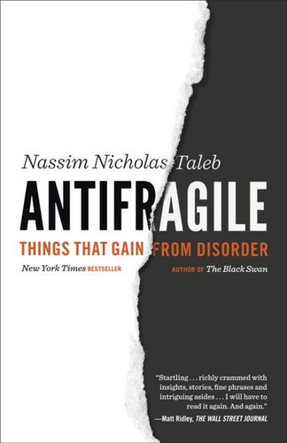 · ### 《反脆弱》 · 纳西姆·塔勒布 · 正文推荐正文明确推荐：「我很少推荐书籍，觉得在当下这种环境，更值得去看看。脆弱的反面，不是刚强，而是反脆弱。」 · 立即查看 ↗ ·](https://www.jinjiancheng.com/go/book-antifragile?source=booklist&amp;placement=book-card)
- [· 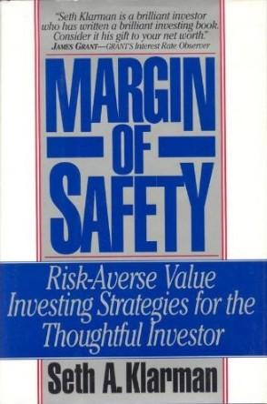 · ### 《安全边际》 · 塞思·卡拉曼 · 正文推荐正文推荐：「我的风格比较相似。下跌时不恐慌逢低买入，上涨时不追高逢高减仓。」 · 立即查看 ↗ ·](https://www.jinjiancheng.com/go/book-margin-of-safety?source=booklist&amp;placement=book-card)
- [· 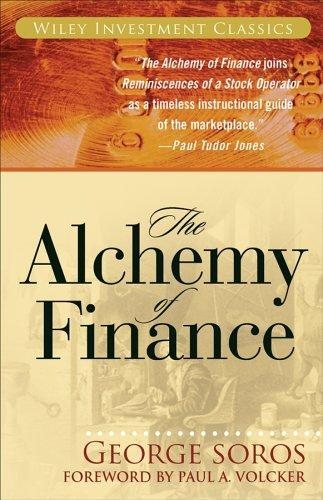 · ### 《金融炼金术》 · 索罗斯 · 评论区推荐：「这两本可以先看看，前者是索罗斯著。」 · 立即查看 ↗ ·](https://www.jinjiancheng.com/go/book-alchemy-of-finance?source=booklist&amp;placement=book-card)
- [·  · ### 《穷查理宝典》 · 芒格 · 评论区推荐，收录芒格二十年公开演讲。 · 立即查看 ↗ ·](https://www.jinjiancheng.com/go/book-poor-charlies-almanack?source=booklist&amp;placement=book-card)
- [· 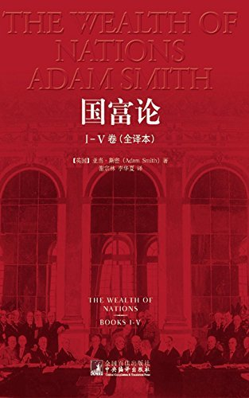 · ### 《国富论》 · 亚当·斯密 · 评论区提及：「比较经典的入门级书籍。」 · 立即查看 ↗ ·](https://www.jinjiancheng.com/go/book-wealth-of-nations?source=booklist&amp;placement=book-card)
- [· 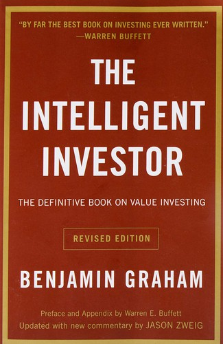 · ### 《聪明的投资者》 · 本杰明·格雷厄姆 · 评论区推荐，也写作《最聪明的投资者》。 · 立即查看 ↗ ·](https://www.jinjiancheng.com/go/book-intelligent-investor?source=booklist&amp;placement=book-card)
- [· 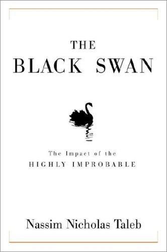 · ### 《黑天鹅》 · 纳西姆·塔勒布 · 评论区推荐，与《随机漫步的傻瓜》一并提及。 · 立即查看 ↗ ·](https://www.jinjiancheng.com/go/book-black-swan?source=booklist&amp;placement=book-card)
- [· 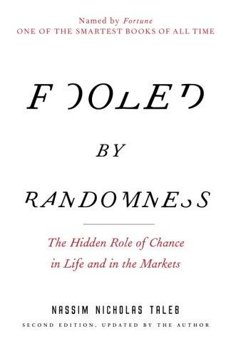 · ### 《随机漫步的傻瓜》 · 纳西姆·塔勒布 · 评论区推荐，与《黑天鹅》并列。 · 立即查看 ↗ ·](https://www.jinjiancheng.com/go/book-fooled-by-randomness?source=booklist&amp;placement=book-card)
- [· 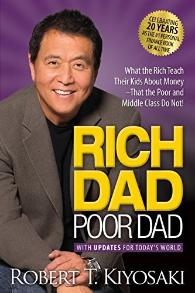 · ### 《穷爸爸富爸爸》 · 罗伯特·清崎 · 推荐思路：「先买本《穷查理宝典》，吃透后结合《穷爸爸富爸爸》给孩子讲解。」 · 立即查看 ↗ ·](https://www.jinjiancheng.com/go/book-rich-dad-poor-dad?source=booklist&amp;placement=book-card)
- [· 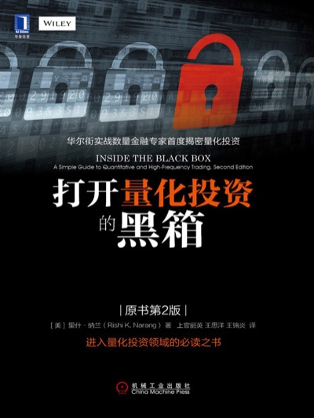 · ### 《打开量化投资的黑箱》 · 评论区推荐，量化投资方向。 · 立即查看 ↗ ·](https://www.jinjiancheng.com/go/book-inside-the-black-box?source=booklist&amp;placement=book-card)
- [· 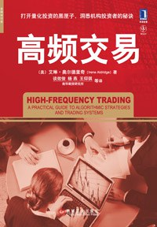 · ### 《高频交易》 · 评论区推荐，量化方向。 · 立即查看 ↗ ·](https://www.jinjiancheng.com/go/book-high-frequency-trading?source=booklist&amp;placement=book-card)
- [· 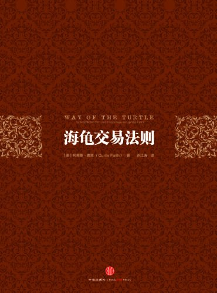 · ### 《海龟交易法则》 · 评论区推荐，量化方向。 · 立即查看 ↗ ·](https://www.jinjiancheng.com/go/book-turtle-trading?source=booklist&amp;placement=book-card)
- [· 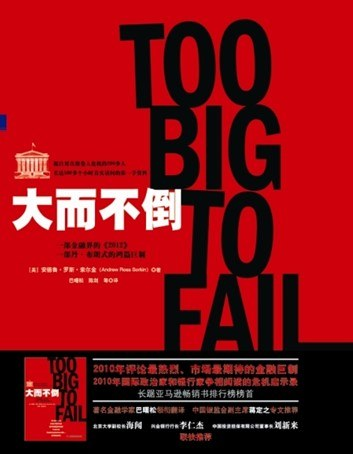 · ### 《大而不倒》 · 正文引用：「总以为自己足够强大，根本不会倒下。事实并非如此。」 · 立即查看 ↗ ·](https://www.jinjiancheng.com/go/book-too-big-to-fail?source=booklist&amp;placement=book-card)
023 本
## 逻辑学类
玑哥自己教孩子时使用的逻辑学教材，也是他反复对读者强调的方向。
- [· 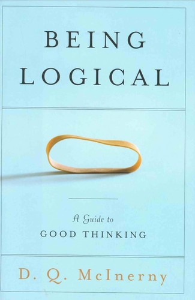 · ### 《简单的逻辑学》 · D.Q. 麦克伦尼 · 正文推荐正文明确推荐：自己教孩子逻辑学用此书，定位为「入门级书籍」，也推荐给读者。 · 立即查看 ↗ ·](https://www.jinjiancheng.com/go/book-being-logical?source=booklist&amp;placement=book-card)
- [· 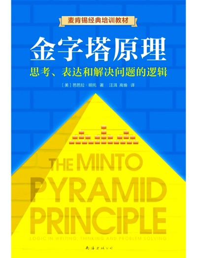 · ### 《金字塔原理》 · 芭芭拉·明托 · 正文推荐正文推荐：大儿子用作进阶逻辑学教材，「学好逻辑学，很多东西就会清晰明了，不那么容易被骗」。 · 立即查看 ↗ ·](https://www.jinjiancheng.com/go/book-pyramid-principle?source=booklist&amp;placement=book-card)
- [· 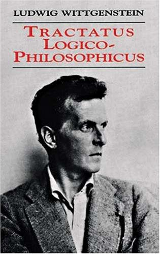 · ### 《逻辑哲学论》 · 维特根斯坦 · 大儿子最喜欢的一本，但「初学者不建议一下子看这本」。 · 立即查看 ↗ ·](https://www.jinjiancheng.com/go/book-tractatus?source=booklist&amp;placement=book-card)
0316 本
## 经典 / 历史 / 人文类
玑哥长期阅读的古今经典，写作中被频繁引用以比照投资与人性。
- [· 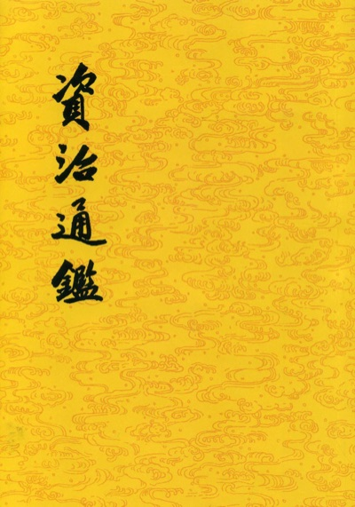 · ### 《资治通鉴》 · 「每年重读一遍」，与四大名著一起循环读。 · 立即查看 ↗ ·](https://www.jinjiancheng.com/go/book-zizhi-tongjian?source=booklist&amp;placement=book-card)
- [· 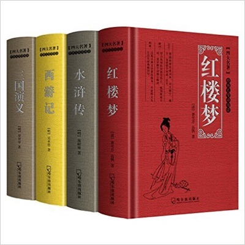 · ### 四大名著（《西游记》《三国演义》等） · 每年重读，常被引用来分析市场与人性。 · 立即查看 ↗ ·](https://www.jinjiancheng.com/go/book-four-classics?source=booklist&amp;placement=book-card)
- [· 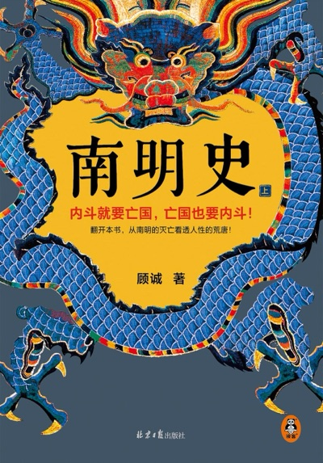 · ### 《南明史》 · 天机奇谈正文：「最近我在重读《南明史》，第六遍」，盛世兴衰皆心平气和。 · 立即查看 ↗ ·](https://www.jinjiancheng.com/go/book-nanming-history?source=booklist&amp;placement=book-card)
- [·  · ### 《第三帝国的兴亡：纳粹德国史》 · 正文推荐正文推荐：「目前看的是英文版。你们如果感兴趣，就找找看有没有 12 年之前的中文版。」 · 立即查看 ↗ ·](https://www.jinjiancheng.com/go/book-rise-fall-third-reich?source=booklist&amp;placement=book-card)
- [· 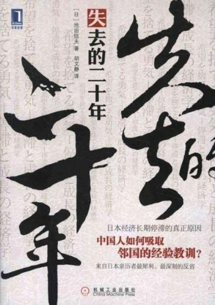 · ### 《失去的二十年》 · 池田信夫 · 正文引用开篇谈日本经济，有深度阅读痕迹。 · 立即查看 ↗ ·](https://www.jinjiancheng.com/go/book-lost-decades?source=booklist&amp;placement=book-card)
- [· 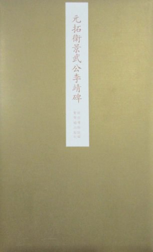 · ### 《卫公兵法》 · 李靖 · 正文推荐：「写得很好，比《孙子兵法》更适合普通人看，朴实无华，大道至简。」 · 立即查看 ↗ ·](https://www.jinjiancheng.com/go/book-weigong-bingfa?source=booklist&amp;placement=book-card)
- [· 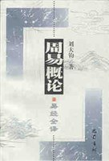 · ### 《易经》 · 正文引用「大衍之数」谈仓位管理。 · 立即查看 ↗ ·](https://www.jinjiancheng.com/go/book-yijing?source=booklist&amp;placement=book-card)
- [· 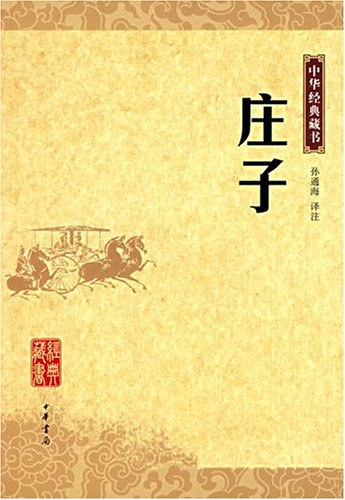 · ### 《庄子》 · 正文引用谈「道德」观。 · 立即查看 ↗ ·](https://www.jinjiancheng.com/go/book-zhuangzi?source=booklist&amp;placement=book-card)
- [· 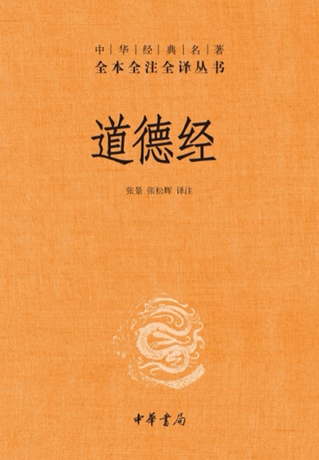 · ### 《道德经》 · 正文引用第四十一章。 · 立即查看 ↗ ·](https://www.jinjiancheng.com/go/book-daodejing?source=booklist&amp;placement=book-card)
- [· 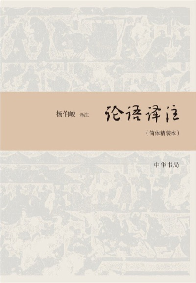 · ### 《论语》 · 正文引用「君子不器」。 · 立即查看 ↗ ·](https://www.jinjiancheng.com/go/book-analects?source=booklist&amp;placement=book-card)
- [· 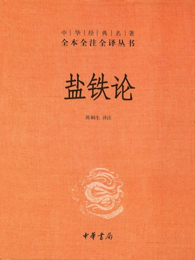 · ### 《盐铁论》 · 正文引用「富在术数，不在劳身」。 · 立即查看 ↗ ·](https://www.jinjiancheng.com/go/book-yantie-lun?source=booklist&amp;placement=book-card)
- [· 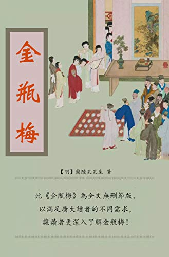 · ### 《金瓶梅》 · 天机奇谈：「年近四旬，我第 24 次看《金瓶梅》，只有一个感悟：在不幸的时代，每个人都是不幸的。」 · 立即查看 ↗ ·](https://www.jinjiancheng.com/go/book-jinpingmei?source=booklist&amp;placement=book-card)
- [· 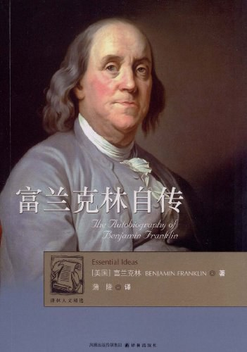 · ### 《富兰克林自传》 · 评论区推荐：「能让人静下心来思考，现在这个环境，多修心。」 · 立即查看 ↗ ·](https://www.jinjiancheng.com/go/book-franklin-autobiography?source=booklist&amp;placement=book-card)
- [· 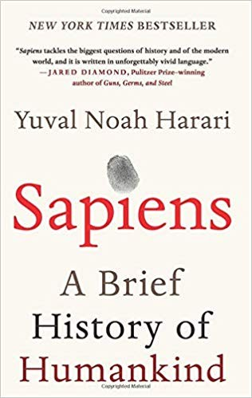 · ### 《人类简史》 · 大儿子在看，推荐看英文原版：「译本删减和修改太严重。」 · 立即查看 ↗ ·](https://www.jinjiancheng.com/go/book-sapiens?source=booklist&amp;placement=book-card)
- [· 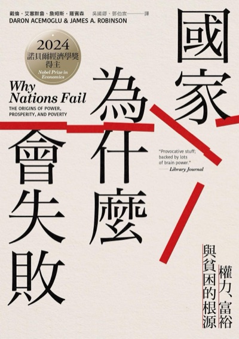 · ### 《国家为什么会失败》 · 大儿子在看，同样推荐英文原版。 · 立即查看 ↗ ·](https://www.jinjiancheng.com/go/book-why-nations-fail?source=booklist&amp;placement=book-card)
- [· 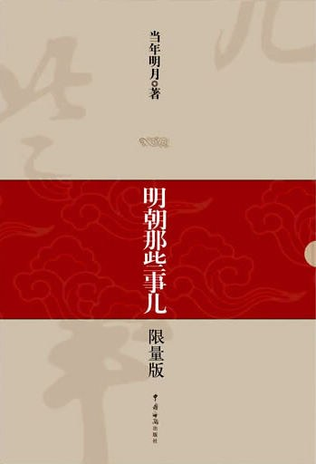 · ### 《明朝那些事》 · 夜晚看盘时消遣读物。 · 立即查看 ↗ ·](https://www.jinjiancheng.com/go/book-mingchao-stories?source=booklist&amp;placement=book-card)
043 本
## 科学 / 思维类
天机奇谈中多次被并列推荐的几本，用来对照人性与本能。
- [· 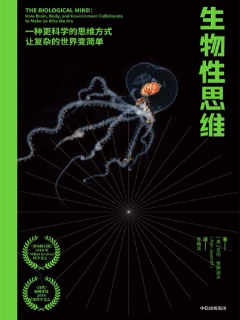 · ### 《生物性思维》 · 天机奇谈正文复读推荐：「后者主要是『做大脑的控制者』」，与《反脆弱》并列。 · 立即查看 ↗ ·](https://www.jinjiancheng.com/go/book-biological-thinking?source=booklist&amp;placement=book-card)
- [· 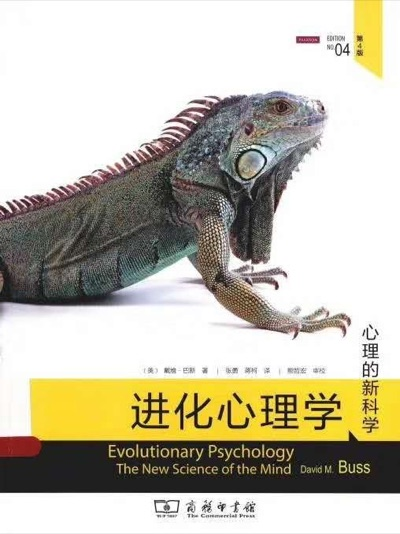 · ### 《进化心理学》 · 正文推荐：认为婚礼誓词应放在《进化心理学》和《自私的基因》上宣誓——「我将违背我的天性，忤逆我的本能，永远爱你」。 · 立即查看 ↗ ·](https://www.jinjiancheng.com/go/book-evolutionary-psychology?source=booklist&amp;placement=book-card)
- [· 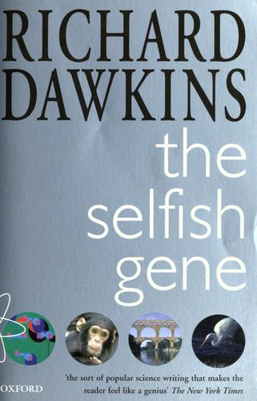 · ### 《自私的基因》 · 理查德·道金斯 · 与《进化心理学》并列推荐，同一段婚礼誓词上下文。 · 立即查看 ↗ ·](https://www.jinjiancheng.com/go/book-selfish-gene?source=booklist&amp;placement=book-card)
054 本
## 亲子 / 青少年类
玑哥给自家孩子和读者家的孩子推荐过的入门读物。
- [· 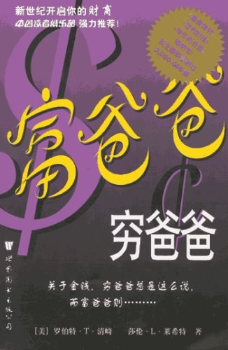 · ### 《富爸爸穷爸爸青少年版》 · 推荐给 12 岁以下孩子，配合实际投资账户一起讲解。 · 立即查看 ↗ ·](https://www.jinjiancheng.com/go/book-rich-dad-teen?source=booklist&amp;placement=book-card)
- [· 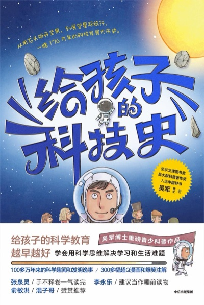 · ### 《给孩子的科技史》 · 给孩子的入门课外书。 · 立即查看 ↗ ·](https://www.jinjiancheng.com/go/book-tech-history-kids?source=booklist&amp;placement=book-card)
- [· 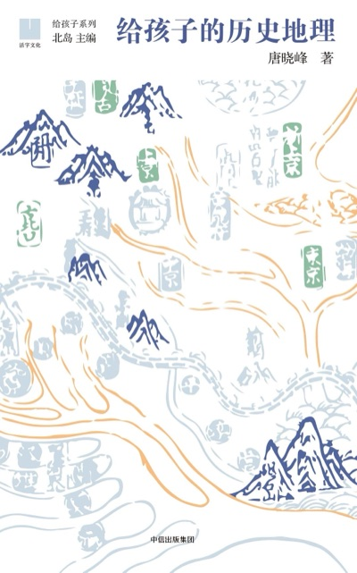 · ### 《给孩子的地理历史》 · 给孩子的入门课外书。 · 立即查看 ↗ ·](https://www.jinjiancheng.com/go/book-geography-history-kids?source=booklist&amp;placement=book-card)
- [· 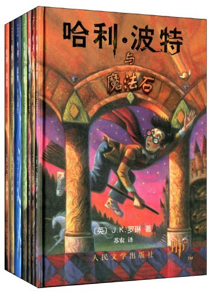 · ### 《哈利波特》 · 推荐给孩子学英语的读物。 · 立即查看 ↗ ·](https://www.jinjiancheng.com/go/book-harry-potter?source=booklist&amp;placement=book-card)
玑哥也说过：**「我很少推荐书籍，能明确写出书名的，都是我认为很不错的书。」**所以本页明确列出书名的每一本，都值得认真对待。
