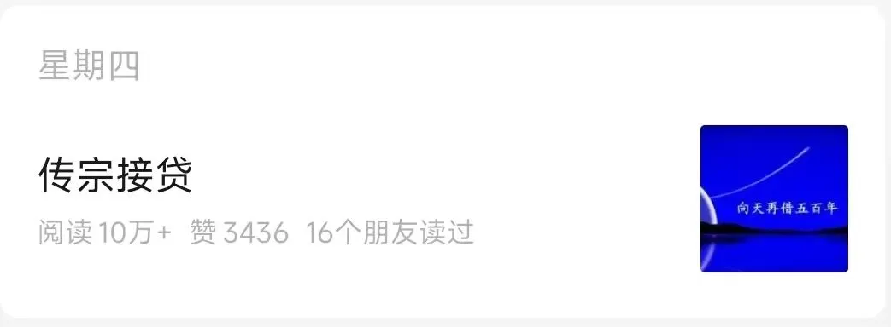
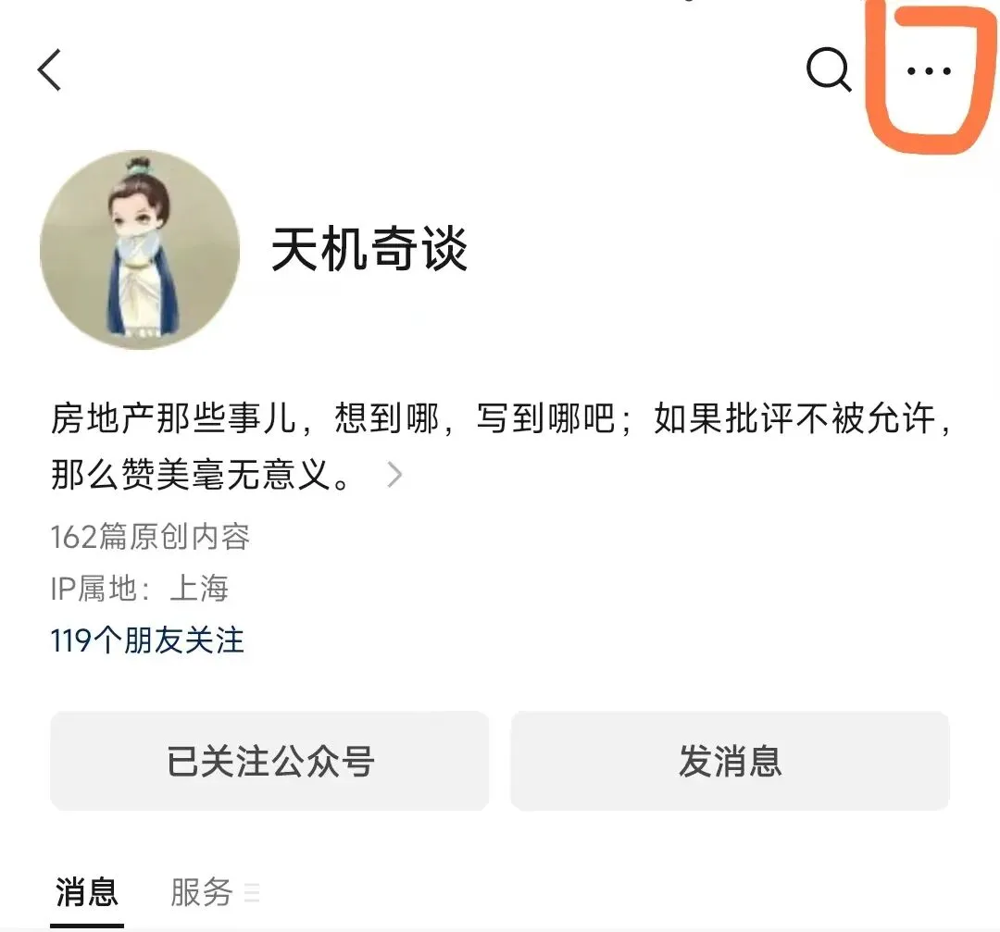
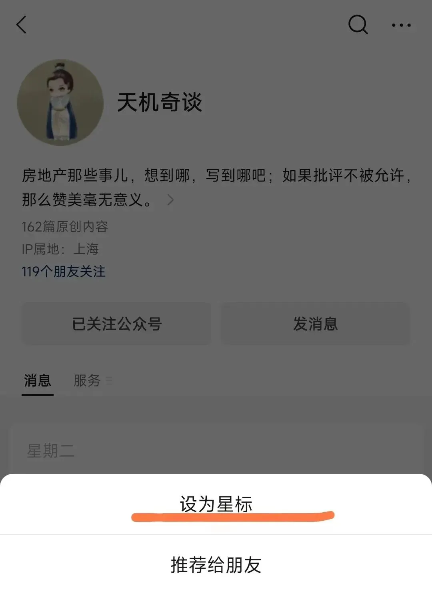
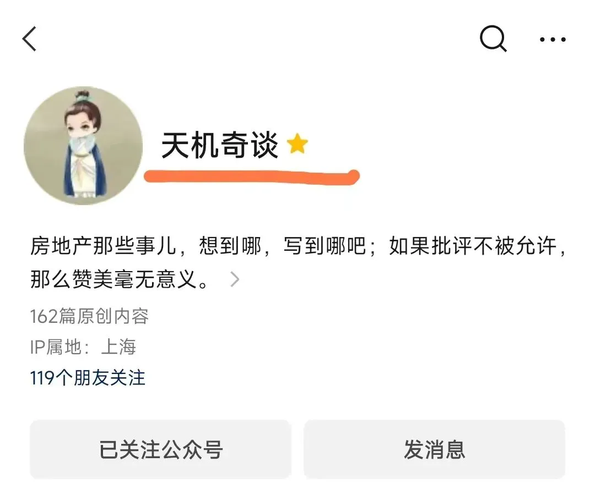

# 事态开始严重了

> 来源：https://www.jinjiancheng.com/articles/tianjiqitan/2023-02-26
> 原文链接：https://mp.weixin.qq.com/s?__biz=Mzg2OTkwNzE4MA%3D%3D&amp;mid=2247490832&amp;idx=1&amp;sn=9c69cd8765d710f54d47e91ed9d14797&amp;scene=27#wechat_redirect

2月初，公众号进行了一次改版。

改版后，几次更新文章，留言被反馈最多的问题分别是：

1、 **没有收到公众号文章更新的信息** ；

2、 **文章封面图变小导致看不清封面图的文字** ；

3、 **系统推送的文章不是最新的，是几天前甚至几周前的** 。

起初，我没有在意。随缘嘛，大家能凑一块唠嗑唠嗑，就很好了。

直到这个问题被屡次提起，才发现，事态开始严重了：

在回答了近百次这个问题后，影响到了我在正常互动和内容创作上的表达欲。

为了解决这个问题，先后请教了腾讯的一位产品经理和几位公众号大V，目前有个有效的解决方式：

**将公众号星标** 。

星标公众号后，更新能及时收到，封面图会变大，推送的文章一般是最新的。封面图会由图一变成图二：

说到底，新规则是根据你的行为来判定是否是公众号的常读用户（或喜欢），常读用户和喜欢的用户，能及时收到最新的推送文章，封面图也是大幅的。

除了文章末尾经常点“赞”和“在看”，星标公众号，也是体现喜欢的方式之一。

具体的操作流程如下：

1、点击下方公众号卡片；

2、点击公众号卡片后，会进入一个界面，界面的右上角，有个“ **···** ”的标识：

3、点击界面右上角的“ **···** ”，会弹出一个新的界面，新界面的第一个选项，就是“ **设为星标** ”：

4、点击这个“设为星标”，就完成操作了，操作完成后，公众号名称“天机奇谈”后，会多一个⭐的标识：

到这里，就成功星标公众号，可以经常按时收到公众号的文章推送，看清封面图的文字了。

就这样吧，明天见。
