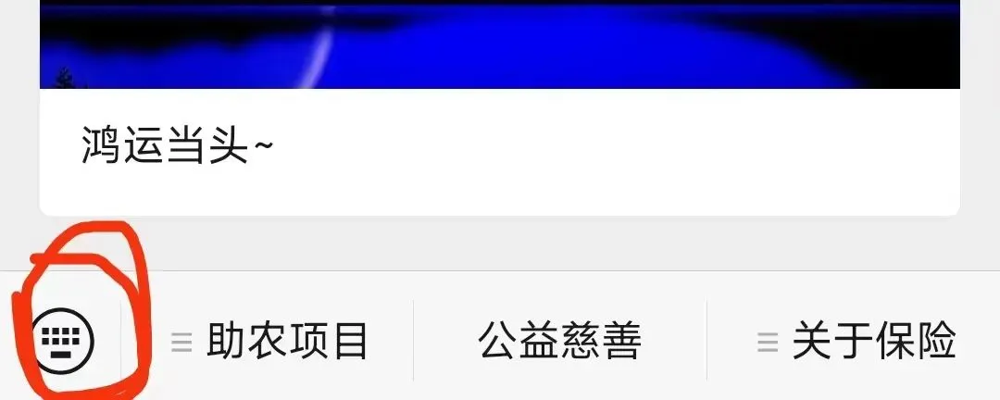
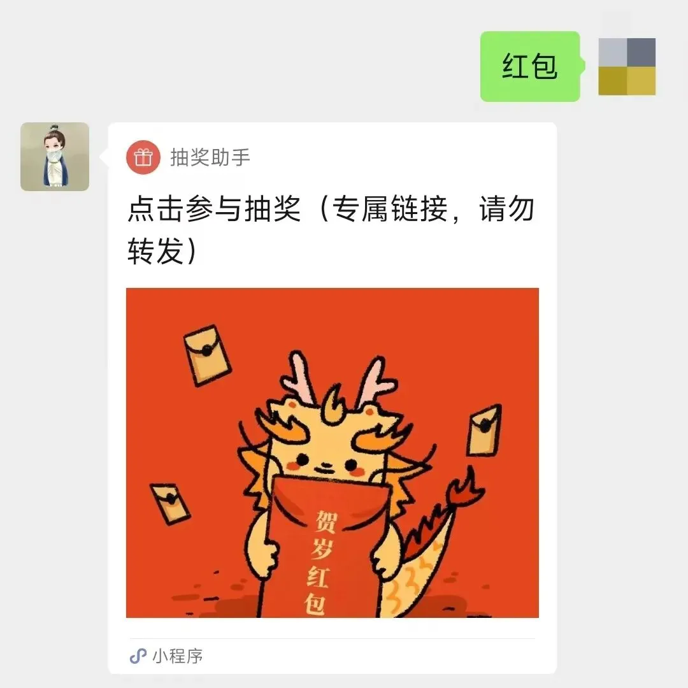

# 鸿运当头

> 来源：https://www.jinjiancheng.com/articles/tianjiqitan/2024-02-02
> 原文链接：https://mp.weixin.qq.com/s?__biz=Mzg2OTkwNzE4MA%3D%3D&amp;mid=2247492072&amp;idx=1&amp;sn=7fc4b43149be34364420c2abbb0a10fb&amp;scene=27#wechat_redirect

助农项目95折最后一天了，需要的看看： 天叙小馆 ，明天下午2点截单，打烊。

写下今年度最后这短篇，我就准备放假了，公司的员工今天开始放假，我也想休息了，去走走看看，预计2月底恢复更新。

春节前给读者们发红包这事，做了两年，去年断了一年（改成发新疆大枣），今年继续恢复发红包。

准备了 **500份红包，每份100元** **，共50000元** 。我很喜欢广东的习俗，总发点红包，金额不大，讲究个“利是”，利是红包，重在参与。
**“利是”是“利事”的谐音，有“事事顺利”的寓意** ，是我对读者的一份祝福。

按之前的说法，是2024年1月24日之前关注的读者才能抽奖，想想今年还是不这么搞了，对后来的读者也不公平，一起乐乐吧，所以今年只要是关注的读者都能参与。

咱们关起门来搞抽奖就行，不要到处转发了，没意义，中奖率也低。

**开奖时间，定在星期日，也就是2月4日20时24分** 。

** 天玑的“利是”红包 ** ** （戳，根据提示操作）  ** ，或直接 **在公众号菜单栏上输入“红包”二字** ，即可参与抽奖，如下图，
**点红圈内的符号** ，然后输入“红包”：

就会有下图这个界面，然后点链接，就可以抽奖了：

就这样吧，祝大家有个愉快的春  节假期
